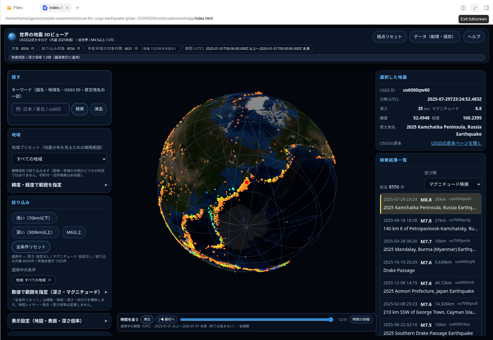

# Local LLM USGS Globe

ローカルLLMで、自分のデータに合う可視化ツールを作る実験の成果物です。USGSの実データを使った日本語3D地震ビュアーを公開します。



## すぐ使う

[Releases](https://github.com/hama-jp/local-llm-usgs-globe/releases)から **index.html** をダウンロードし、Chromeで開いてください。GitHub上のHTMLプレビューでは実行できません。LLM・DGX・Node.jsは再生に不要です。
保存済みの2025年・世界・M4.5以上の地震8,556件と地図を同梱し、外部ネットワークなしで閲覧できます。

- 地表＋海底地形、地表投影／震源表示、表面の非表示、深さ倍率
- 日本語の地域・地名検索、深さ・規模の絞り込み、一覧と赤色選択マーカーの連動
- 月別表示・日単位の時系列再生、CSV、表示設定の保存
- 「データ（取得・保存）」で最新24時間／7日／30日、任意UTC期間のUSGS取得
- 原本・取得URL・日時・SHA-256付きの保存と再読込

詳しくは[使い方](docs/USAGE.md)、[出典](CREDITS.md)、[作成過程と検証](docs/EXPERIMENT.md)。地名の地域範囲は概略矩形です。海底地形は陰影画像です。地震予測・被害予測の道具ではありません。

## 誰が作ったか

アプリ・データ処理・ビルドスクリプトは、既存DeepSeek Harness経由でDGX Spark 3台上の `deepseek-v4.1-flash` が実装しました。Codexは実行環境、取得専用道具、独立検証、Todo・修正指示、配布手順を担当しました。アプリ本体へのCodex直接修正はありませんが、**検証と指示の支援あり**の開発です。

この公開データの例を、非公開データ向けツール作りを考える入口として紹介します。本ビュアーが任意の社内CSVを扱えるという意味ではありません。非公開データで作る場合は、推論接続、道具、ログ、生成アプリの通信先まで自分の管理下に置く必要があります。

## 検証・再ビルド

```sh
python3 tools/check_release.py
node tests/test_browser_acquire.cjs
python3 -m unittest discover -s tests -p 'test_*.py'
```

再ビルドはLinuxのbubblewrap、Node.js、esbuild 0.28.1を使用します。[ビルド手順](docs/BUILD.md)をご覧ください。`source/` はモデルの出力を維持しています。

Chrome LinuxとDSHで実データ照合・オフライン保存往復を検証しました。Safari/Firefox/実機モバイル・大規模上限付近・長時間連続稼働は未検証です。

独自コードは[MIT](LICENSE)。地震・地図・Three.js等は[CREDITS](CREDITS.md)の条件を適用します。
